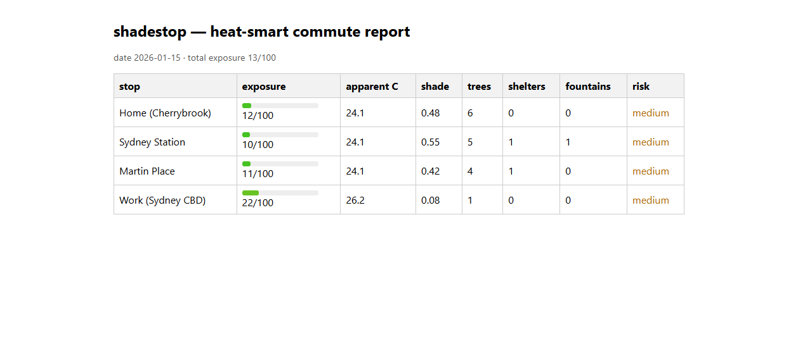

# shadestop

shadestop is a heat-smart commuting tool. It scores transit stops and walking
legs for shade and heat exposure. Then it suggests cooler departure times and
routes.

It uses free public data: Open-Meteo weather, OpenStreetMap shade assets, and
GTFS stop feeds. No API keys. No paid services.

## Screenshots

The static web view renders a stop-level score report from `web/report.json`.



*Web report — exposure scores and heat risk per stop from the bundled demo data (2026-01-15, total exposure 13/100). Run it yourself:
`npx tsx src/index.ts export --commute plan.json --format json --out web/report.json`, then serve the repo root and open `/web/`.*

## Install

```
npm install
```

Requires Node 20 or newer. Zero runtime dependencies. Only dev tools.

## Use

Run commands from the repo root:

```
npx tsx src/index.ts <command> [options]
```

### score

Score a commute plan for heat exposure.

```
npx tsx src/index.ts score --commute plan.json [--cache-dir dir] [--json]
```

### suggest

Suggest cooler departure times and water stops.

```
npx tsx src/index.ts suggest --commute plan.json [--json]
```

### export

Export the council report.

```
npx tsx src/index.ts export --commute plan.json [--format csv|json] [--out file]
```

### gtfs-stops

Extract stop coordinates from a GTFS feed.

```
npx tsx src/index.ts gtfs-stops --feed feed.zip [--out stops.json] [--city sydney]
```

### demo

Run the full pipeline offline with bundled fixtures. No network needed.

```
npx tsx src/index.ts demo
```

## Commute plan format

A plan is JSON. It has an origin, a destination, intermediate stops, and legs.
Each leg links two stops and names the travel mode and minutes.

```
{
  "name": "my commute",
  "origin":  { "id": "o", "name": "Home", "lat": -33.66, "lon": 150.66 },
  "destination": { "id": "d", "name": "Work", "lat": -33.874, "lon": 151.213 },
  "stops": [
    { "id": "s1", "name": "Sydney Station", "lat": -33.8724, "lon": 151.2083, "gtfsStopId": "SYD" }
  ],
  "legs": [
    { "from": "o", "to": "s1", "mode": "train", "minutes": 45 },
    { "from": "s1", "to": "d", "mode": "walk", "minutes": 12 }
  ]
}
```

Walk and ride legs are heat-exposed. Vehicle legs are not scored.

## How it works

- **Apparent temperature** — BOM formula with Magnus vapor pressure.
- **Heat base** — 0 at 20C apparent, 1 at 40C and above.
- **Shade fraction** — OSM trees, shelters, and fountains within 100 m.
- **Exposure score** — blends heat base, shade cut, and a midday sun penalty.
- **Departure suggestion** — scores every hour 05:00 to 21:00 and ranks.

See `SPEC.md` for the exact model and `PLAN.md` for the build record.

## Data sources

- Open-Meteo forecast API (temperature, humidity, solar radiation). Free.
- OpenStreetMap via Overpass (trees, shelters, fountains). Free.
- GTFS static feeds (stop coordinates). Free where published.

## Web view

A static page at `web/index.html` loads a JSON report and shows the table.
No build step. Open it with a local server:

```
npx tsx src/index.ts export --commute plan.json --format json --out web/report.json
python3 -m http.server 8000
# open http://localhost:8000/web
```

## Limitations

- Sun model ignores daylight saving and the equation of time.
- Shade data is only as good as OpenStreetMap tagging.
- The public Overpass endpoints are sometimes at capacity. The tool degrades
  to zero shade and prints a warning instead of failing.

## License

MIT
